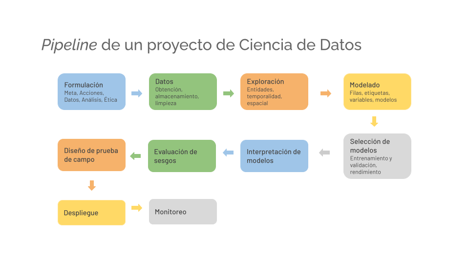

### Retomemos:




### Lo que vamos a aprender:

- Qué es una API y en qué se diferencia de una app o de una página web.
- Identificar endpoints, métodos HTTP, códigos de estado, encabezados y cuerpos de solicitud.
- Levantar una API con FastAPI y consultar una base DuckDB con `myquery`.
- Probar una API REST con `curl` y con la documentación interactiva de FastAPI.
- Consumir una API desde Python con pandas para usar sus resultados en un análisis.

### Cómo lo vamos a aprender

La unidad va de lo conceptual a lo visible:

1. **Concepto (secciones 1 y 2):** qué es una API, qué es un endpoint y qué significan los códigos de estado. Lo vemos con diagramas y ejemplos, sin programar.
2. **API en la terminal (sección 3, pasos 1 a 3):** levantamos la API y la probamos con `curl` y con la documentación de FastAPI.
3. **API en un notebook (sección 3, paso 4):** consumimos la misma API con pandas y comparamos el resultado con `myquery`.
4. **App de monitoreo (sección 4):** leemos una app de Dash y la corremos para ver los datos en una página.

Antes de empezar necesitas la base `data/db/ecobici.duckdb` creada y el proyecto sincronizado con `uv sync`.

## 1. ¿Qué es una API?

Imagina que ya tienes el resumen de viajes en tu notebook, con `myquery`. Ahora otra persona necesita esos números, pero no debería copiar una base de 1.3 millones de filas ni tener acceso directo a DuckDB. Una API resuelve eso: expone los resultados para que cualquiera los pida por red.

Una **API** (*Application Programming Interface*) es un punto de conexión que permite que una aplicación se comunique con otra. No tiene interfaz visual: recibe solicitudes, las procesa y devuelve respuestas, normalmente en formato **JSON**.

Una API es el intermediario que traduce solicitudes y datos entre sistemas. Algunas de sus funciones típicas son:

1. Acceder a datos desde cualquier lugar, por ejemplo, un servicio de clima que responde en tiempo real.
2. Iniciar sesión con una sola cuenta en varias aplicaciones.
3. Interactuar con servicios o recursos de un sistema, como una base de datos.

### App, página web y API

| Concepto | Qué es | Ejemplo |
|---|---|---|
| **App** | Programa que realiza una tarea específica, con o sin interfaz | Excel, un script que limpia datos |
| **Página web** | Interfaz visual que se muestra en el navegador (HTML, CSS, JavaScript) | Un dashboard con gráficas |
| **API** | Canal de comunicación entre aplicaciones, sin interfaz visual | La API de un servicio de clima |

### Tres piezas, tres roles

En este curso distinguimos:

- **Base (DuckDB)**: guarda los datos limpios de m10.
- **API (FastAPI)**: entrega datos o resultados a quien los pida, en JSON. No muestra gráficas.
- **App de monitoreo (Dash)**: muestra gráficas a una persona. Es un programa aparte y **no** consume la API en esta unidad.

### REST

Existen varios tipos de API. La más común en servicios web es **REST**, que usa HTTP (el mismo protocolo que usa tu navegador) y es **sin estado**: cada solicitud contiene toda la información que el servidor necesita para procesarla. El servidor no recuerda solicitudes anteriores.

## 2. Endpoints, métodos y respuestas

Un **endpoint** es una URL específica donde se accede a un recurso o se realiza una acción, por ejemplo `https://api.com/users`.

Los **métodos HTTP** indican qué se quiere hacer:

- `GET`: obtener datos.
- `POST`: crear un recurso o enviar datos.
- `PUT` / `PATCH`: actualizar datos existentes.
- `DELETE`: eliminar un recurso.

Los **códigos de estado** indican el resultado de la solicitud:

- `200 OK`: la solicitud fue exitosa.
- `201 Created`: se creó un recurso.
- `400 Bad Request`: la solicitud tiene un error, como datos inválidos.
- `404 Not Found`: el recurso no existe.
- `422 Unprocessable Entity`: un parámetro no cumple las reglas (por ejemplo, un límite fuera de rango).
- `500 Internal Server Error`: hubo un error en el servidor.

Los **encabezados** (*headers*) son metadatos que acompañan la solicitud o la respuesta. Por ejemplo, `Content-Type` indica en qué formato viene el cuerpo. El **cuerpo** (*body*) lleva datos en `POST` o `PUT`, generalmente en JSON.

```text
┌──────────────────────────────────────────┐
│              Página web (UI)             │
│      HTML + CSS + JS (frontend)          │
│      Ej: botón “Ver retiros”             │
└──────────────────────────────────────────┘
                     │
                     ▼
          (envía solicitud HTTP GET)
                     │
┌──────────────────────────────────────────┐
│              API (Backend)               │
│              FastAPI                     │
│  Ej: recibe /estaciones/1/retiros        │
│  → devuelve [{"fecha_retiro": ...}]      │
└──────────────────────────────────────────┘
                     │
                     ▼
┌──────────────────────────────────────────┐
│           App / Lógica interna           │
│   Consultas SQL sobre la base DuckDB     │
│   Ej: SELECT ... FROM clean.ecobici      │
└──────────────────────────────────────────┘
```

## 3. Práctica: la API de EcoBici

En esta sección pasamos de la idea a la práctica: levantamos la API, la probamos y la usamos desde Python.

La API del proyecto está en `src/progra/api/main.py`. Expone la tabla `clean.ecobici` que construimos en m10. Las consultas pasan por `myquery` (`src/progra/tools/mydb.py`), la misma función que usas en tus notebooks; los valores van como parámetros (`?`).

| Método | Endpoint | Qué devuelve |
|---|---|---|
| `GET` | `/health` | Estado de la API |
| `GET` | `/resumen` | Total de viajes, fechas y edad promedio |
| `GET` | `/viajes/por-genero` | Número de viajes por género |
| `GET` | `/estaciones/{estacion_id}/retiros?limite=10` | Últimos retiros de una estación |

### Paso 1. Levantar la API

Necesitas la base `data/db/ecobici.duckdb` creada con el pipeline de m10. Desde la raíz del repositorio:

```{.sh}
uv run uvicorn progra.api.main:app --reload --port 13000
```

No necesitas configurar la ruta de la base: `myquery` la resuelve desde el código y apunta a `data/db/ecobici.duckdb`.

### Paso 2. Probar con `curl`

Abre otra terminal:

```{.sh}
# Estado de la API
curl http://localhost:13000/health

# Resumen de la tabla
curl http://localhost:13000/resumen

# Viajes por género
curl http://localhost:13000/viajes/por-genero

# Cinco últimos retiros de la estación 1
curl "http://localhost:13000/estaciones/1/retiros?limite=5"
```

Prueba los errores a propósito:

```{.sh}
# Estación sin registros: 404
curl -i http://localhost:13000/estaciones/99999/retiros

# Límite fuera de rango: 422
curl -i "http://localhost:13000/estaciones/1/retiros?limite=500"
```

Observa que `curl -i` muestra el código de estado y los encabezados de la respuesta.

### Paso 3. Documentación interactiva

FastAPI genera documentación automática a partir del código. Abre en tu navegador:

```text
http://localhost:13000/docs
```

Desde ahí puedes probar cada endpoint con el botón **Try it out**.

### Paso 4. Consumir la API desde Python

Para un análisis no necesitas `curl`: pandas puede leer la respuesta JSON directamente. Con la API corriendo, en un notebook:

```{.python}
import pandas as pd

viajes_genero = pd.read_json("http://localhost:13000/viajes/por-genero")
viajes_genero
```

Compara el resultado con `myquery` usando el mismo SQL de `viajes_por_genero` en `main.py`. Deberían coincidir: la API solo cambia la forma de entregar el resultado.

### Paso 5. Preguntas de análisis

- ¿Qué datos pediría otra persona para su análisis, y qué endpoint los entrega?
- `/estaciones/{id}/retiros` tiene un límite máximo de 100. ¿Por qué lo pondrías? ¿Qué pasaría con una consulta sin límite sobre 1.3 millones de filas?
- Si llegan datos de marzo a la base, ¿cambian los números de `/resumen`? ¿Cómo lo comprobarías?
- `/resumen` muestra una fecha `desde` de 2013, aunque los archivos son de 2014. ¿Qué validación de m10 ayudaría a detectar eso?
- ¿Qué información de la base no deberías exponer a cualquiera que conozca la URL?

## 4. Dash: una app para ver los datos

La API responde a programas. Para que una persona vea los datos en una página, usamos **Dash**. Dash es un framework de Python para construir **apps web interactivas** con gráficas: la persona elige opciones en un menú y la página se actualiza, sin escribir HTML ni JavaScript. Lo desarrolla Plotly y usa Flask por dentro.

| | API (FastAPI) | App (Dash) |
|---|---|---|
| Qué entrega | JSON | Una página web con gráficas |
| Quién la usa | Programas, notebooks, otros sistemas | Una persona en el navegador |
| Interactividad | Cada solicitud es independiente | Los controles actualizan las gráficas |

### Tres ideas para leer una app de Dash

1. **Layout**: la estructura de la página. Se arma con componentes de `dash.html` (títulos, divisiones) y `dash.dcc` (menús y gráficas).
2. **Id**: cada control o gráfica tiene un `id` que lo identifica.
3. **Callback**: una función que se ejecuta cuando cambia una entrada (`Input`) y actualiza una salida (`Output`).

Esta es una versión simplificada de `src/progra/analysis/app_ecobici.py`:

```{.python}
import plotly.express as px
from dash import Dash, dcc, html, Input, Output

app = Dash(__name__)

app.layout = html.Div([
    dcc.Dropdown(
        id="variable",
        options=[{"label": "Género", "value": "genero"},
                 {"label": "Edad", "value": "edad"}],
        value=None,
    ),
    dcc.Graph(id="grafico", figure={}),
])

@app.callback(
    Output("grafico", "figure"),
    Input("variable", "value"),
)
def actualizar_grafico(variable):
    if not variable:
        return {}
    return px.histogram(df, x=variable, color="genero")
```

Cuando la persona elige una opción en el menú, Dash llama a `actualizar_grafico` con ese valor y coloca la figura que regresa en el componente `grafico`.

::: {.callout-tip}
## Los datos se cargan una vez
`df` se llena al iniciar la app con `myquery` y no en cada clic. Por eso la app responde rápido, pero también significa que si la base cambia, hay que reiniciar la app. La consulta incluye `limit 10000` para que la app no cargue toda la tabla.
:::

### Correr la app

Desde la raíz del repositorio:

```{.sh}
uv run python src/progra/analysis/app_ecobici.py
```

Abre `http://localhost:8050`. Puede correr al mismo tiempo que la API, que usa el puerto 13000.

Prueba: agrega una opción al menú para `estacion_retiro` y observa qué gráfica aparece. ¿Por qué sería útil ver los datos por estación?

## 5. Relación con las unidades anteriores

- **m10**: la tabla `clean.ecobici` es el origen de todos los endpoints.
- **m11**: las consultas usan `myquery`, que lee la base de `data/db/ecobici.duckdb`.
- **Próximas unidades**: en m12 empaquetaremos el pipeline con Docker; en m13 veremos la integración; en m14 veremos credenciales y cómo proteger la API con un token.

## Referencias

- [FastAPI](https://fastapi.tiangolo.com/)
- [Documentación de HTTP: métodos](https://developer.mozilla.org/es/docs/Web/HTTP/Methods)
- [Documentación de HTTP: códigos de estado](https://developer.mozilla.org/es/docs/Web/HTTP/Status)
- [Qué es REST](https://aws.amazon.com/es/what-is/restful-api/)
